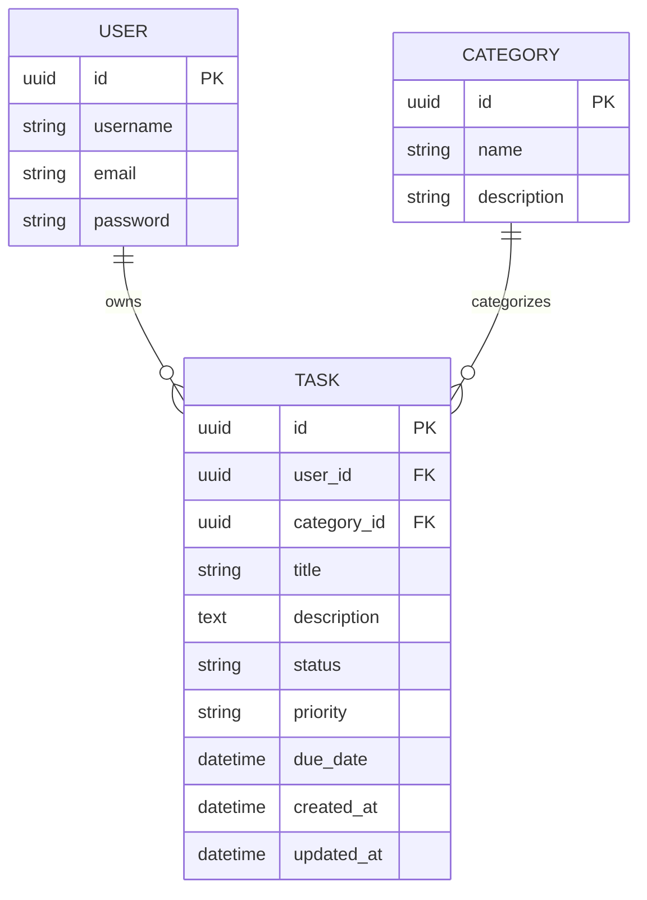

# Task Manager API

A RESTful Task Management API designed to help individuals and teams organize, manage, track, and prioritize their daily activities through a centralized backend service.

The project focuses on building a secure, maintainable, and scalable backend infrastructure with user authentication, task management, data validation, and structured API endpoints.

---

## Project Overview

The Task Manager API provides the backend infrastructure for a task management application.

Users can create accounts, authenticate, manage personal tasks, assign priorities, track task progress, and organize their workloads.

The API is designed to support future integration with web and mobile applications.

## Core Features

### 1. User Authentication
- User registration.
- Secure login and logout.
- JWT-based authentication.
- Access and refresh token management.
- Password hashing.
- Protected API endpoints.

### 2. Task Management
- Create new tasks.
- Retrieve all tasks.
- Retrieve individual task details.
- Update existing tasks.
- Delete tasks.
- Associate tasks with authenticated users.

### 3. Task Organization
- Task categorization.
- Priority management.
- Due dates and deadlines.
- Task status tracking.
- Task filtering and searching.
- Task sorting and pagination.

### 4. Task Status Management

Tasks support the following statuses:

| Status | Description |
|---|---|
| TODO | Task has not started |
| IN_PROGRESS | Task is currently being worked on |
| COMPLETED | Task has been finished |
| CANCELLED | Task has been cancelled |

### 5. Task Prioritization

| Priority | Description |
|---|---|
| LOW | Tasks with minimal urgency |
| MEDIUM | Tasks with normal importance |
| HIGH | Tasks requiring attention |
| URGENT | Tasks requiring immediate attention |

---

## Technology Stack

| Component | Technology |
|---|---|
| Backend Framework | Django |
| API Framework | Django REST Framework |
| Database | PostgreSQL |
| Authentication | JWT |
| ORM | Django ORM |
| API Documentation | Swagger / OpenAPI |
| Package Management | uv |
| Version Control | Git & GitHub |
| Testing | Pytest / Django Test Framework |
| Containerization | Docker (optional) |

---

## System Architecture

The application follows a modular REST API architecture.

```text
             CLIENT APPLICATION
              (Web / Mobile)
                     |
                     v
                REST API
                     |
                     v
             DJANGO REST FRAMEWORK
                     |
          +----------+----------+
          |          |          |
          v          v          v
       USERS       TASKS     CATEGORIES
          |          |          |
          +----------+----------+
                     |
                     v
                 DJANGO ORM
                     |
                     v
                 POSTGRESQL
```

### Architectural Responsibilities

- **Django:** Application logic and backend infrastructure.
- **Django REST Framework:** API endpoints, serializers, and request handling.
- **PostgreSQL:** Persistent relational data storage.
- **JWT:** Stateless API authentication.
- **Django ORM:** Database queries and model management.

---

## Database Design

The initial database design consists of the following entities:

| Entity | Responsibility |
|---|---|
| User | Stores user account information |
| Task | Stores task information and progress |
| Category | Organizes tasks into categories |

### Task Model

Suggested task attributes:

| Field | Data Type | Description |
|---|---|---|
| id | UUID | Unique task identifier |
| user | Foreign Key | Task owner |
| title | String | Task title |
| description | Text | Task details |
| status | Choice | Current task status |
| priority | Choice | Task priority |
| category | Foreign Key | Task category |
| due_date | DateTime | Task deadline |
| created_at | DateTime | Creation timestamp |
| updated_at | DateTime | Last modification timestamp |

### Entity Relationship Diagram



---

## API Endpoints

### Authentication

| Method | Endpoint | Description |
|---|---|---|
| POST | `/api/auth/register/` | Register a new user |
| POST | `/api/auth/login/` | Authenticate user |
| POST | `/api/auth/token/refresh/` | Refresh access token |
| GET | `/api/auth/me/` | Retrieve authenticated user |

### Tasks

| Method | Endpoint | Description |
|---|---|---|
| GET | `/api/tasks/` | Retrieve user's tasks |
| POST | `/api/tasks/` | Create a task |
| GET | `/api/tasks/{id}/` | Retrieve task details |
| PUT | `/api/tasks/{id}/` | Update a task |
| PATCH | `/api/tasks/{id}/` | Partially update a task |
| DELETE | `/api/tasks/{id}/` | Delete a task |

### Categories

| Method | Endpoint | Description |
|---|---|---|
| GET | `/api/categories/` | Retrieve categories |
| POST | `/api/categories/` | Create a category |
| GET | `/api/categories/{id}/` | Retrieve category details |
| PUT | `/api/categories/{id}/` | Update a category |
| DELETE | `/api/categories/{id}/` | Delete a category |

### Filtering and Search

Example requests:

```http
GET /api/tasks/?status=IN_PROGRESS
GET /api/tasks/?priority=HIGH
GET /api/tasks/?category=1
GET /api/tasks/?search=project
GET /api/tasks/?ordering=due_date
```

---

## Project Structure

```text
task-manager-api/
│
├── config/
│   ├── settings.py
│   ├── urls.py
│   ├── asgi.py
│   └── wsgi.py
│
├── apps/
│   ├── users/
│   │   ├── models.py
│   │   ├── serializers.py
│   │   ├── views.py
│   │   ├── urls.py
│   │   └── tests.py
│   │
│   ├── tasks/
│   │   ├── models.py
│   │   ├── serializers.py
│   │   ├── views.py
│   │   ├── urls.py
│   │   └── tests.py
│   │
│   └── categories/
│       ├── models.py
│       ├── serializers.py
│       ├── views.py
│       ├── urls.py
│       └── tests.py
│
├── tests/
├── .env.example
├── .gitignore
├── manage.py
├── pyproject.toml
└── README.md
```

---

## Getting Started

### Prerequisites

- Python 3.12+
- PostgreSQL
- Git
- uv

### 1. Clone Repository

```bash
git clone https://github.com/YOUR_USERNAME/task-manager-api.git

cd task-manager-api
```

### 2. Install Dependencies

```bash
uv sync
```

### 3. Configure Environment Variables

Create a `.env` file:

```env
DEBUG=True
SECRET_KEY=your-secret-key

DB_NAME=task_manager
DB_USER=your-database-user
DB_PASSWORD=your-database-password
DB_HOST=localhost
DB_PORT=5432
```

### 4. Apply Database Migrations

```bash
uv run python manage.py makemigrations

uv run python manage.py migrate
```

### 5. Create Administrator

```bash
uv run python manage.py createsuperuser
```

### 6. Run Development Server

```bash
uv run python manage.py runserver
```

The API will be available at:

```text
http://127.0.0.1:8000/
```

---

## API Documentation

The project is intended to provide interactive API documentation through:

- Swagger UI: `/api/docs/`
- OpenAPI Schema: `/api/schema/`
- ReDoc: `/api/redoc/`

---

## Security Considerations

- JWT authentication.
- Secure password hashing.
- User-specific task access.
- Request validation.
- Permission-based API access.
- Protection against unauthorized task modification.
- Environment-based secret management.
- Authentication rate limiting.

**Important:** Users must only be able to access and modify their own tasks unless explicit sharing functionality is implemented.

---

## Testing

The project aims to maintain automated tests covering:

- User registration and authentication.
- JWT token validation.
- Task creation and retrieval.
- Task updates and deletion.
- Task ownership and authorization.
- Category management.
- Filtering, searching, and pagination.
- Invalid request handling.

Run tests using:

```bash
uv run python manage.py test
```

---

## Development Roadmap

| Phase | Deliverable | Status |
|---|---|---|
| 1 | Project initialization | Planned |
| 2 | Database configuration | Planned |
| 3 | User authentication | Planned |
| 4 | Task CRUD operations | Planned |
| 5 | Category management | Planned |
| 6 | Filtering and searching | Planned |
| 7 | API documentation | Planned |
| 8 | Automated testing | Planned |
| 9 | Deployment | Planned |

---

## Future Enhancements

- Team collaboration.
- Task sharing and assignment.
- Subtasks and dependencies.
- Recurring tasks.
- Email notifications.
- Deadline reminders.
- Activity history and audit logs.
- Task analytics and productivity dashboards.
- WebSocket-based real-time updates.
- Calendar integration.

---

## Contributing

Contributions are welcome.

1. Fork the repository.
2. Create a feature branch.
3. Implement your changes.
4. Write and run tests.
5. Submit a pull request.

---

## License

This project is currently under development. Licensing information will be added once finalized.

---

**Task Manager API**

*Organize. Prioritize. Execute.*
